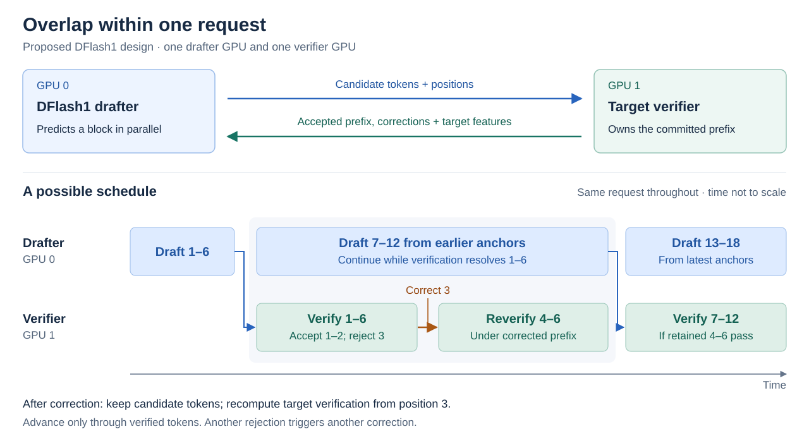
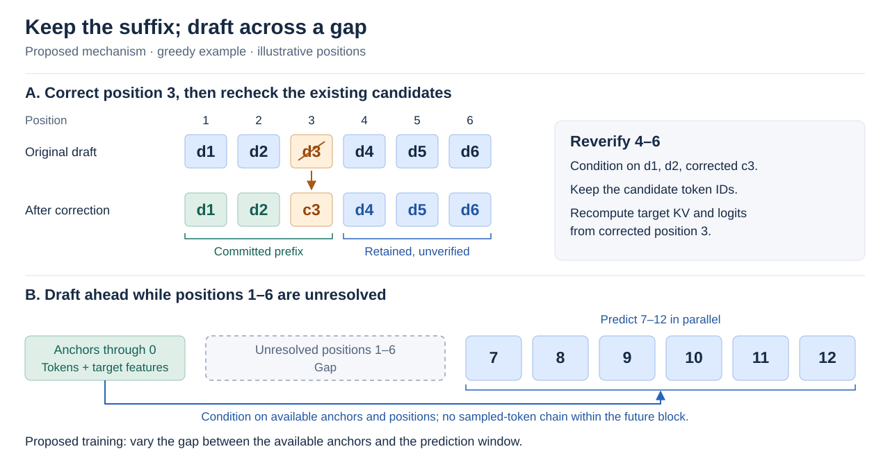

# Our method: overlap within one request

**Keep both GPUs working on the same request.** While the verifier checks an
earlier block, DFlash1 drafts farther ahead. A correction need not discard every
later candidate.

**Two ingredients:** reverify retained tokens under the corrected prefix, and
train DFlash1 to predict across gaps from available anchors. Its parallel block
predictions do not feed each sampled token into the next prediction.

These are proposed schedules, not measured timings. Our [first experiment](../hypothesis/suffix-reuse.md)
tests suffix survival; gap training and asynchronous execution are next.
