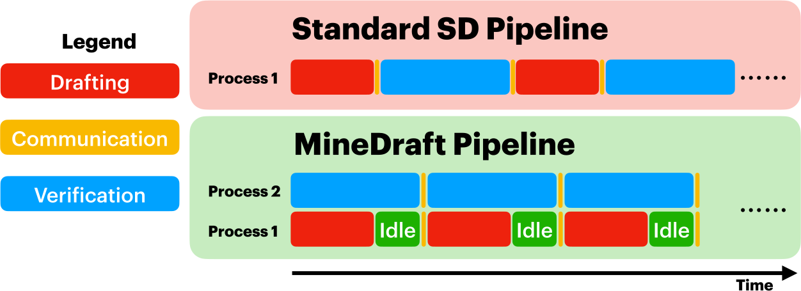
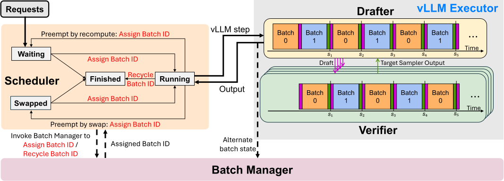
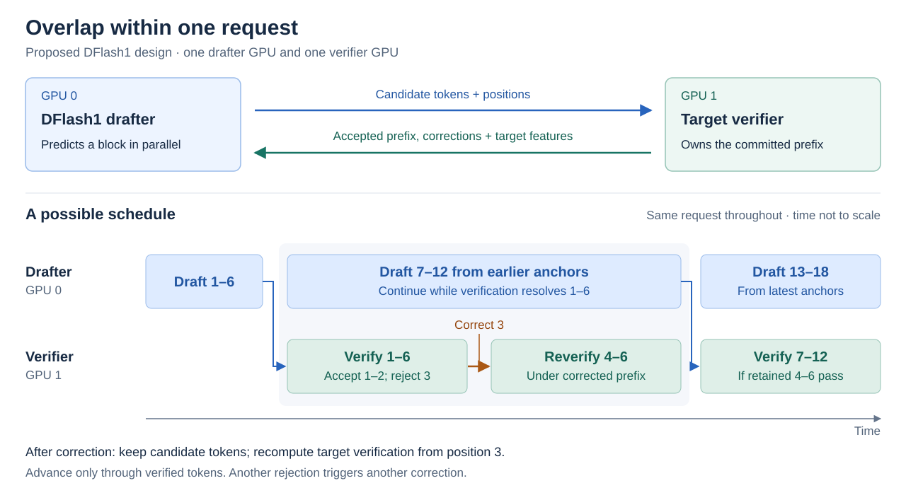
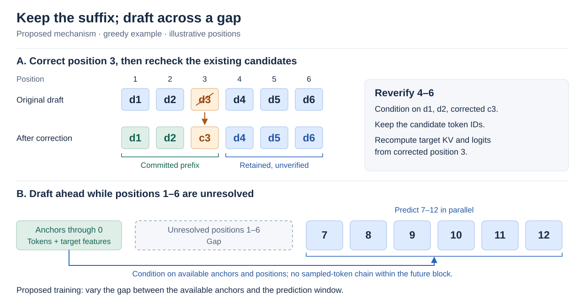

# System design

## MineDraft: overlap across requests

### My understanding

My understanding is that MineDraft dedicates some GPUs to drafting to hide
drafting behind target verification. Without speculative decoding, all GPUs
could instead be used by the target model for next-token prediction.

The core design is asynchronous execution across batches: the target and drafter
work on different batches rather than taking turns on the same batch. This means
a smaller effective request batch at the target, with the potential for better
latency and throughput by committing multiple tokens per request in each
verification pass.

**Figure 1.** Separate GPUs overlap drafting and verification. The concurrent work
belongs to different request batches.

**Figure 2.** A scheduler and batch manager alternate two batches: draft one while
verifying the other, then swap roles. Draft tokens and verification results flow
between workers.

Both figures are reproduced unchanged from [Tang et al., MineDraft, v3](https://arxiv.org/html/2603.18016v3),
under [CC BY 4.0](https://creativecommons.org/licenses/by/4.0/).
[Original assets and attribution](vendor/minedraft/SOURCE.md).

## Our proposal: overlap within one request

**Keep both GPUs working on the same request.** While the verifier checks an
earlier block, DFlash1 drafts farther ahead. A correction need not discard every
later candidate.

**Two ingredients:** reverify retained tokens under the corrected prefix, and
train DFlash1 to predict across gaps from available anchors. Its parallel block
predictions do not feed each sampled token into the next prediction.

These are proposed schedules, not measured timings. Our [first experiment](../hypothesis/suffix-reuse.md)
tests suffix survival; gap training and asynchronous execution are next.
